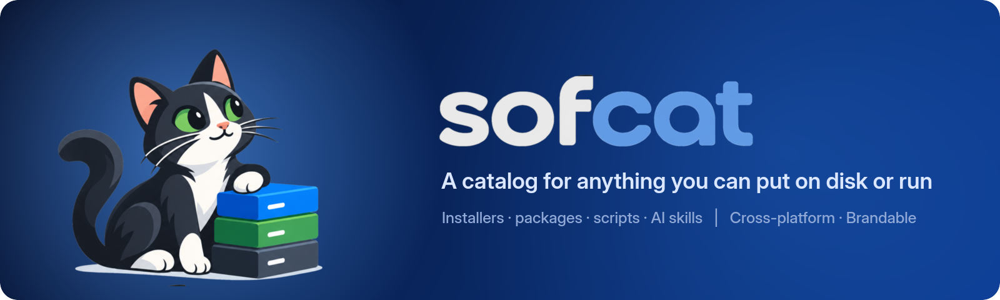
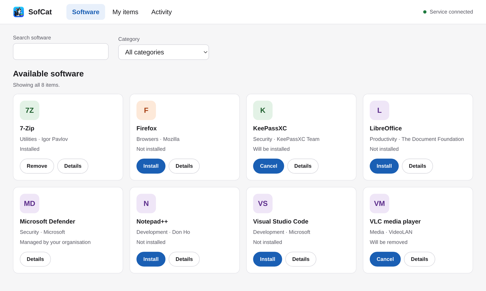
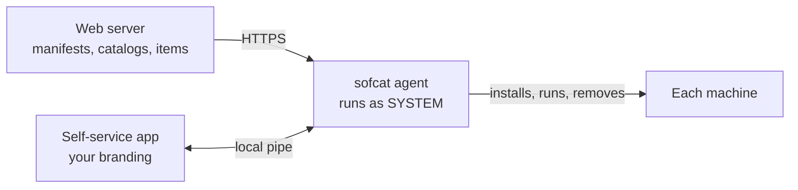

<p align="center">
  
</p>

<p align="center">
  <a href="https://github.com/hurricanehrndz/sofcat/actions/workflows/checks.yml"></a>
  <a href="https://github.com/hurricanehrndz/sofcat/actions/workflows/go-test.yml"></a>
  <a href="https://github.com/hurricanehrndz/sofcat/actions/workflows/windows-integration-tests.yml"></a>
  <a href="https://scorecard.dev/viewer/?uri=github.com/hurricanehrndz/sofcat"></a>
  <a href="https://github.com/hurricanehrndz/sofcat/releases"></a>
  <a href="LICENSE"></a>
</p>

> [!WARNING]
> SofCat is pre-beta. The config keys, catalog format and service protocol can
> change between releases without a migration path. Only the Windows agent
> ships today.

SofCat is a catalog for anything you can put on disk or run: installers,
packages, scripts, AI skills. You publish manifests and catalogs on any web
server. An agent on each machine keeps the required items in place, and a
self-service app, branded as your own, lets people add the optional ones
without admin rights.

It started as a fork of [Gorilla](https://github.com/1dustindavis/gorilla) and
keeps the [Munki](https://github.com/munki/munki) model: a manifest says what a
machine gets, catalogs say what exists, and both are plain YAML.

<picture>
  <source media="(prefers-color-scheme: dark)" srcset="assets/readme/storefront-dark.png">
  
</picture>

## Where it stands

| | Today | Planned |
| --- | --- | --- |
| Agent | Windows service | macOS and Linux |
| Item types | `.msi`, `.exe`, `.ps1`, `.nupkg` via [Chocolatey](https://github.com/chocolatey/choco) | Files and scripts on any platform, AI skills, native packages |
| Self-service app | Windows | macOS and Linux |
| `makecatalogs` | Linux, macOS, Windows | |

What already works:

- **Self-service for standard users.** Browse, install, remove and cancel,
  with per-item progress and an Activity log. The app talks to the agent over
  a local named pipe, so nobody needs to elevate.
- **Your branding.** Set the app's title, logo, accent colour and help link
  with policy registry values or `config.yaml`. See
  [ui/README.md](ui/README.md#branding).
- **Inventory for osquery.** Every run writes a Munki-compatible
  `inventory.json`. See [docs/osquery-inventory.md](docs/osquery-inventory.md).
- **`makecatalogs` anywhere.** Build catalogs on any OS, so your repo's CI
  never needs a Windows runner.

## How it works



## Quick start on Windows

1. Download `sofcat-<version>-x86_64.msi` from the
   [releases page](https://github.com/hurricanehrndz/sofcat/releases) and install it:

   ```powershell
   msiexec /i sofcat-<version>-x86_64.msi /qn
   ```

   The MSI puts both executables in `C:\Program Files\SofCat`, registers the
   `sofcat` service and adds a Start-menu shortcut to the app. It ships no
   config.

2. Write `C:\ProgramData\SofCat\config.yaml` and point it at your repo:

   ```yaml
   url: https://example.com/sofcat/
   manifest: example_manifest
   catalogs:
     - example_catalog
   app_data_path: C:/ProgramData/SofCat
   ```

3. `Restart-Service sofcat`.

[examples/](examples/) has an annotated config, catalog, manifest and
package-info file. [docs/data-directory.md](docs/data-directory.md) explains
what lives in `C:\ProgramData\SofCat` and who can write to it.

Nothing is code signed yet.

## Build catalogs with makecatalogs

`makecatalogs` compiles a repo's `packages-info/*.yaml` into
`catalogs/<catalog>.yaml`, like Munki's tool of the same name. It is a
standalone pure-Go binary and reads no SofCat config.

```sh
makecatalogs [--check] <repo_path>
```

- Without `--check` it replaces `<repo_path>/catalogs/`. It skips a
  package-info file with no `catalog`, a catalog name containing a path, or
  one that differs from another only by case, and warns. A duplicate item
  name within a catalog warns, and the later file wins. If nothing is left to
  write it fails and leaves `catalogs/` alone. It ignores dotfiles such as
  `._foo.yaml`.
- `--check` validates the repo, prints what it would write, and writes
  nothing. It fails on those warnings too, which makes it a good pull-request
  gate for a package repo.
- Exit codes are `0` for success, `1` for any error (or any problem under
  `--check`) and `2` for a usage error.

Releases publish `makecatalogs-<os>-<arch>[.exe]` for Linux, macOS and Windows
on amd64 and arm64. See
[examples/example_package-info.yaml](examples/example_package-info.yaml).

`sofcat -build`/`-b` and `-import`/`-i` are gone, along with the `repo_path`
config key. Configs that still set it keep loading.

## Build from source

You need Go 1.26, Node 22 and [`just`](https://github.com/casey/just).
[mise](https://mise.jdx.dev) installs all three plus the lint and format tools:

```sh
mise install
just setup   # frontend deps and the pre-commit hook
just build   # build/sofcat.exe and build/sofcat-ui.exe
just msi     # build/sofcat-<version>-x86_64.msi
```

Both executables are pure Go with no cgo, so they cross-compile from Linux or
macOS. `just msi` uses [embala](https://github.com/hurricanehrndz/embala), so
WiX isn't needed either. More in [docs/dev.md](docs/dev.md) and
[ui/README.md](ui/README.md).

## Contributing

Pull requests are welcome. Before you open one, run:

```sh
just fmt-check
just lint
just test
just ui-lint ui-test   # if you touched ui/
```

To try the whole thing on a fresh Windows VM, start with
[test/manual/README.md](test/manual/README.md).

## Credits

SofCat is a fork of [Gorilla](https://github.com/1dustindavis/gorilla) by
Dustin Davis and borrows its model from [Munki](https://github.com/munki/munki).
Licensed under [Apache-2.0](LICENSE).
